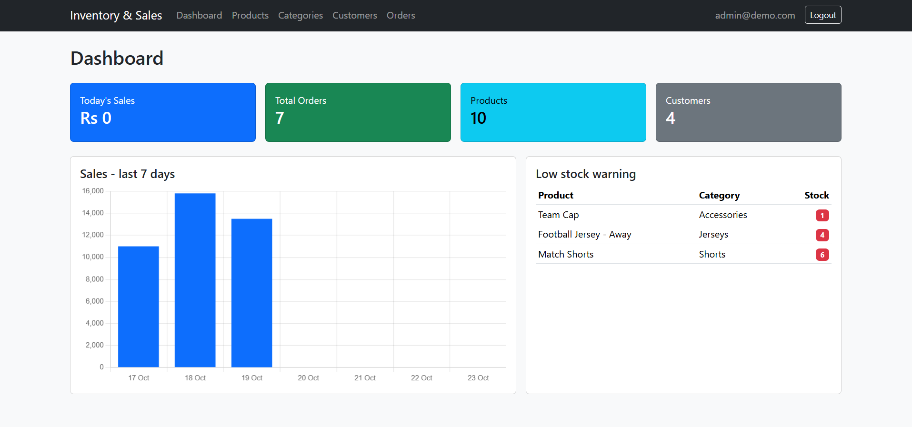
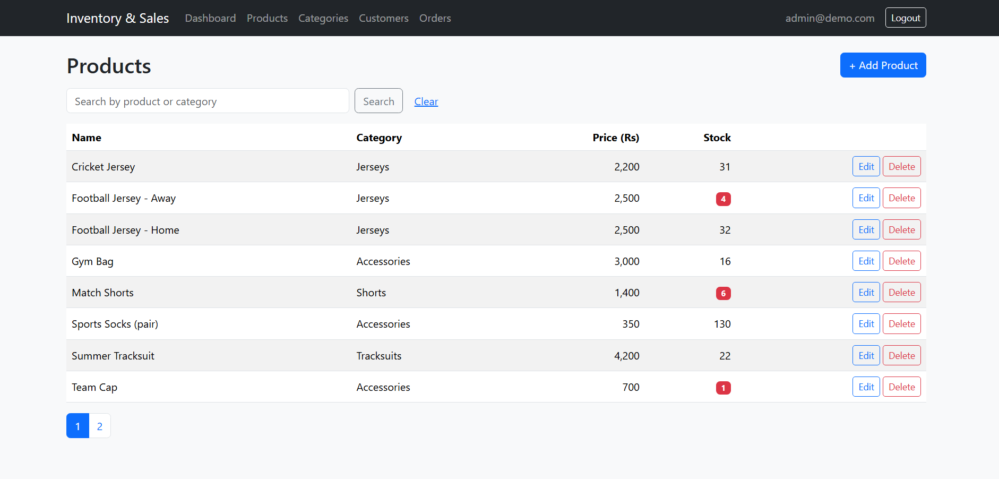

# Inventory & Sales Manager – ASP.NET Core MVC, SQL Server, Bootstrap (one single application, a "monolith")

A web app for a small shop or factory to keep track of products, stock, customers and sales orders, and to print an invoice for each sale.

I built it to practise how a real business system fits together, from login to invoice, instead of making another list-and-form demo. The part I care about most: when you save an order, the total is calculated and the stock goes down in the same step, and if anything fails nothing is saved.

| Role | Email | Password |
|---|---|---|
| Admin | admin@demo.com | Admin@123 |
| Staff | staff@demo.com | Staff@123 |

Live Preview;- https://inventory-sales-app.tryasp.net/

## Screenshots

**Dashboard.** Today's sales, totals, the last 7 days as a chart, and a list of products running low.

**New order.** Pick a customer and the products. The total and the new stock are worked out when you save.

**Invoice.** Each order has an invoice page you can print or save as PDF.

**Products.** Search by product or category, with pages for long lists.

## Who can do what

| | Admin | Staff |
|---|---|---|
| View dashboard, products, categories, customers, orders | Yes | Yes |
| Add and edit products, categories, customers | Yes | Yes |
| Create orders, print invoices, export to Excel | Yes | Yes |
| Delete products, categories, customers | Yes | No |

Orders cannot be deleted by anyone. A sale is a record, so I did not want it to disappear. The same idea protects data: a category that still has products, a customer who has orders, or a product that was sold cannot be deleted.

The roles are checked on the server, not only hidden in the menu, so Staff cannot delete by typing the address.

## Screens

- **Login:** email and password, using ASP.NET Core Identity.
- **Dashboard:** sales today, totals, a 7-day sales chart, and products with fewer than 10 in stock.
- **Products:** list, search, add, edit, delete (Admin).
- **Categories:** add, edit, delete (Admin).
- **Customers:** search, add, edit, delete (Admin).
- **New order:** choose a customer, fill in the product rows you need (empty rows are ignored).
- **Orders:** all orders, newest first, with an invoice page and an Excel export.

## How an order is saved

1. Keep only the filled rows, and merge the same product if it appears twice.
2. Check that the customer exists.
3. Check that there is enough stock for every row. If not, show a clear message and save nothing.
4. Build the order, using the product price at that moment, and reduce the stock.
5. Save the order and the new stock together in one go.

The price is copied into the order, so old invoices don't change when a product price changes later.

## Tech stack

- ASP.NET Core MVC on .NET 10, C#
- Entity Framework Core with SQL Server (Code First, Fluent API)
- ASP.NET Core Identity for login and roles
- Bootstrap 5 for the layout, Chart.js for the sales chart
- ClosedXML for the Excel export
- xUnit tests for the order rules

